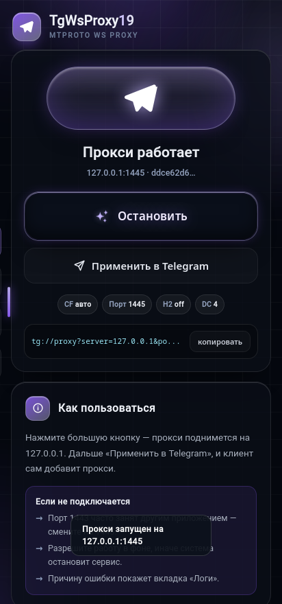
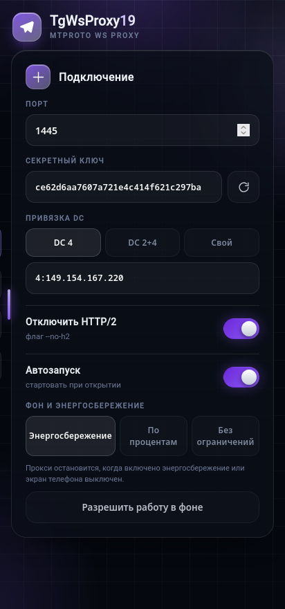
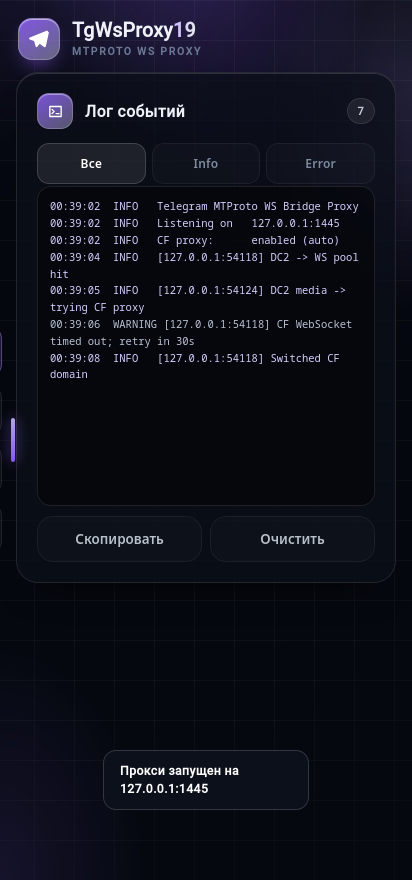
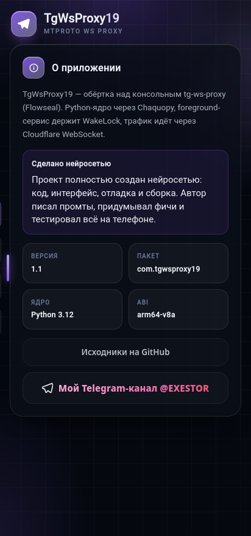

<div align="center">

# TgWsProxy19

**Локальный MTProto-прокси для Android — обёртка над консольным [tg-ws-proxy](https://github.com/Flowseal/tg-ws-proxy)**

[](#)
[](#)
[](#)
[](#)

[📥 Скачать APK](https://github.com/EXESTOR/TgWsProxy19/releases/latest) •
[💬 Telegram-канал](https://t.me/EXESTOR)

</div>

<p align="center">
  
</p>

## Что это

Приложение поднимает **локальный MTProto-прокси** на `127.0.0.1`, который
перенаправляет трафик Telegram через WebSocket-соединения. Данные остаются
зашифрованными, сторонние серверы не используются.

Python-ядро ([tg-ws-proxy](https://github.com/Flowseal/tg-ws-proxy)) работает
внутри APK через **Chaquopy**, а интерфейс — локальный HTML/CSS/JS в WebView
с мостом в Kotlin. Вся нативная часть (сервис, WakeLock, настройки, уведомление)
написана на Kotlin.

## Возможности

- ▶️ **Запуск одной кнопкой** — большая state-кнопка со свечением, анимацией букв и конфетти;
- 🔔 **Foreground-сервис** — постоянное уведомление со статусом и кнопкой «Остановить»;
- 🔒 **WakeLock** — система не усыпляет прокси во время работы;
- ⚙️ **Настройки** — порт, secret (32 hex), `--no-h2`, привязка DC (`--dc-ip`);
- 🚀 **Автозапуск** — прокси поднимается сам при открытии приложения;
- 🔋 **Политика фона** — остановка по системному энергосбережению, по порогу заряда
  (5–60 %) или без ограничений;
- 🌙 **Экран выключен — прокси остановлен** (в режиме «Энергосбережение»);
- 📲 **Применить в Telegram** — ссылка `tg://proxy` открывается сразу в Telegram;
- 📜 **Живые логи** — фильтры Все / Info / Error, копирование и очистка;
- 🎨 **Тёмная тема** — пепельный / тёмно-синий / фиолетовый, стеклянные панели,
  выезжающая слева капсула-навигация.

## Скриншоты

<p align="center">
  
  
  
  
</p>

## Как это работает

```
Telegram → MTProto-прокси (127.0.0.1:1443) → WebSocket (TLS) → DC Telegram
```

1. Python-ядро поднимает MTProto-прокси на `127.0.0.1` в отдельном потоке с собственным `asyncio`-циклом.
2. Из obfuscation-пакета извлекается номер DC (и признак media).
3. Устанавливается WebSocket-соединение к нужному DC; если WS недоступен — fallback на Cloudflare-прокси или прямое TCP.
4. Kotlin держит процесс живым: foreground-сервис + WakeLock, останавливает по политике фона.

## Установка

Скачай APK со [страницы релизов](https://github.com/EXESTOR/TgWsProxy19/releases/latest):

| Файл | Архитектура | Python | Кому |
|---|---|---|---|
| `TgWsProxy19-arm64-v8a-debug.apk` | `arm64-v8a` + `x86_64` | 3.12 | современные телефоны (2018+) |
| `TgWsProxy19-armv7-debug.apk` | `armeabi-v7a` | 3.11 | старые 32-битные устройства |

> Пакет у обеих сборок один (`com.tgwsproxy19`), поэтому установить можно только одну.
> Требуется Android 8.0 (API 26) и выше.

## Подключение в Telegram

1. Открой приложение и нажми большую кнопку — прокси поднимется на `127.0.0.1:1443`.
2. Нажми **«Применить в Telegram»** — откроется клиент с готовой ссылкой `tg://proxy`.
3. Подтверди подключение.

Или вручную: Telegram → Настройки → Продвинутые настройки → Тип подключения → Прокси →
MTProto, сервер `127.0.0.1`, порт из настроек, secret из приложения.

> [!IMPORTANT]
> Порт **1443** часто занят другим прокси-приложением. Если прокси не стартует —
> смени порт на 1445 в настройках.

## Настройки

| Параметр | По умолчанию | Описание |
|---|---|---|
| Порт | `1443` | локальный порт прокси |
| Secret | генерируется | 32 hex-символа, кнопка «Обновить ключ» |
| Отключить HTTP/2 | вкл | флаг `--no-h2` |
| Привязка DC | `4:149.154.167.220` | можно несколько: `2:149.154.167.220 4:149.154.167.220` |
| Автозапуск | вкл | старт при открытии приложения |
| Фон | Энергосбережение | политика остановки (см. ниже) |

### Фон и энергосбережение

- **Энергосбережение** — прокси останавливается, когда включён системный режим
  энергосбережения **или выключен экран телефона**.
- **По процентам** — остановка, когда заряд опускается до выбранного значения (5–60 %).
- **Без ограничений** — прокси работает, пока его не остановят вручную.

## Сборка из исходников

Нужно:

- JDK 17+;
- Android SDK с платформой **34** (`local.properties` → `sdk.dir=...`);
- Python **3.12** для основной сборки и **3.11** для armv7 (Chaquopy требует
  ту же минорную версию на машине сборки).

```bash
# основная сборка: arm64-v8a + x86_64, Python 3.12
./gradlew assembleDebug

# legacy: armeabi-v7a, Python 3.11
./gradlew assembleDebug -PlegacyArm=true
```

Готовый APK: `app/build/outputs/apk/debug/app-debug.apk`.

## Структура проекта

```
app/src/main/
  assets/ui/index.html          интерфейс (HTML/CSS/JS, без фреймворков)
  java/com/tgwsproxy19/
    App.kt                      старт Python
    MainActivity.kt             WebView + мост
    WebAppBridge.kt             JS ↔ Kotlin
    ProxyForegroundService.kt   сервис, WakeLock, политика фона
    PyBridge.kt                 вызовы Python
  python/runner.py              запуск прокси в потоке, логи
  python/proxy/*.py             ядро tg-ws-proxy
docs/screenshots/               скриншоты для README
```

## Известные ограничения

- Chaquopy 15 собирает нативные библиотеки с выравниванием под 4 КБ, поэтому
  Android 15+ при установке показывает предупреждение про страницы памяти 16 КБ.
  На 4 КБ-устройствах всё работает; предупреждение можно закрыть кнопкой
  «Больше не показывать».
- После переустановки APK прокси останавливается — открой приложение, автозапуск поднимет его снова.

## Автор

Сделано **EXESTOR** — [Telegram-канал](https://t.me/EXESTOR).

Проект полностью создан нейросетью: код, интерфейс, отладка и сборка.
Автор формулировал задачи и промты, выбирал дизайн и тестировал на телефоне.

## Благодарности

- [Flowseal/tg-ws-proxy](https://github.com/Flowseal/tg-ws-proxy) — ядро прокси;
- [Chaquopy](https://chaquo.com/chaquopy/) — Python в Android.

